# Alicorp: ¿qué está impulsando sus resultados? (2024–2026)

Análisis de los resultados trimestrales de **Alicorp**, la mayor empresa de consumo masivo del Perú, con datos públicos: sus reportes de resultados y el tipo de cambio del BCRP. Cubre 10 trimestres, del 1T24 al 2T26, y sus 4 unidades de negocio.

**Herramientas:** Python (pandas, matplotlib) · SQL (SQLite) · Excel · Power BI (modelo estrella + DAX)

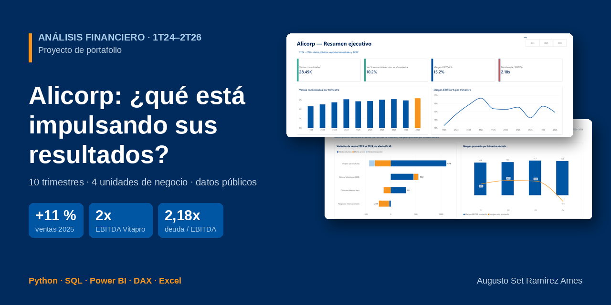

## Las preguntas de negocio
1. ¿Las ventas crecen por precio o por volumen?
2. ¿Qué unidad de negocio impulsa la ganancia y cuál la frena?
3. ¿Por qué la utilidad neta sale negativa en algunos trimestres?
4. ¿Cómo está cambiando la deuda con las adquisiciones?

## Respuestas en corto
| Pregunta | Respuesta |
|---|---|
| ¿Precio o volumen? | **Volumen.** En 2025 se vendieron 19 % más toneladas, pero a menor precio promedio por kilo; ninguna unidad creció por subir precios, salvo B2B. |
| ¿Qué unidad impulsa y cuál frena? | **Vitapro impulsó 2025** (EBITDA ×2) y **Consumo Masivo Perú sostiene el negocio** (casi la mitad del EBITDA). **Negocios Internacionales frena**, por el cambio de tipo de cambio en Bolivia. |
| ¿Por qué hay utilidad neta negativa? | Por **partidas contables de cierre de año** (deterioros, reestructuración), no por la operación: el EBITDA de esos trimestres es normal. |
| ¿Cómo cambia la deuda? | **Sube con las adquisiciones:** de 1,83x a 2,18x EBITDA entre dic-24 y jun-26. Manejable, pero en aumento. |

## Hallazgos
1. **Alicorp vende más toneladas, pero cada tonelada vale menos.** En 2025 las ventas subieron 11 % (S/ 10 598 M → 11 764 M) y el volumen 19 %. El precio promedio bajó de S/ 5,0 a S/ 4,7 por kilo porque crecieron más los negocios de alto volumen y bajo precio por kilo (alimento acuícola de Vitapro, insumos B2B) que los de consumo masivo.
2. **Vitapro fue el motor de 2025 y en 2026 se frena.** Su EBITDA ajustado se duplicó (USD 71 M → 143,5 M), su margen pasó de 8,8 % a 13,8 % y su peso en el EBITDA del grupo subió de 16 % a 29 %. En el primer semestre de 2026 vende 13 % más toneladas, pero su EBITDA cae 11 %.
3. **Consumo Masivo Perú es el corazón del negocio.** Aporta 45–52 % del EBITDA con el mejor margen (≈ 20–22 %). En el primer semestre de 2026 se recupera (ventas +10,6 %, EBITDA +17,7 %), en parte por empresas adquiridas como Inka Crops.
4. **Bolivia: un cambio contable que se ve como una caída.** Desde 2025 Alicorp convierte Bolivia con un tipo de cambio de mercado (NIC 21). Las ventas de Negocios Internacionales caen aunque las toneladas casi no cambien: 2024 y 2025 no son comparables para esa unidad.
5. **Las pérdidas de los 4T son contables, no operativas.** La utilidad neta fue negativa en el 4T24 (−S/ 108 M) y el 4T25 (−S/ 63 M). En el 4T25 hubo S/ 283 M de partidas no recurrentes, sobre todo un deterioro de S/ 191 M en Bolivia, mientras el EBITDA ajustado se mantuvo estable.
6. **Las adquisiciones se pagan con deuda.** La deuda financiera neta pasó de S/ 3 090 M (dic-24) a S/ 3 850 M (jun-26), +25 %, y el apalancamiento de 1,83x a 2,18x.
7. **El crecimiento de 2025 fue casi todo volumen.** En Vitapro (+S/ 678 M) el efecto precio fue −S/ 315 M; en Consumo Masivo Perú (+S/ 151 M), −S/ 140 M. En Negocios Internacionales (−S/ 231 M) el 90 % de la caída es efecto precio. Solo Alicorp Soluciones (B2B) ganó por precio y por volumen a la vez.
8. **Los cuartos trimestres son sistemáticamente peores en utilidad neta, no en EBITDA.** El margen EBITDA es parejo todo el año (14,8 %–15,7 %), pero el margen neto cae a −2,8 % en promedio en Q4: las partidas no recurrentes promedian S/ 205 M en Q4 frente a S/ 6–18 M en los otros trimestres.

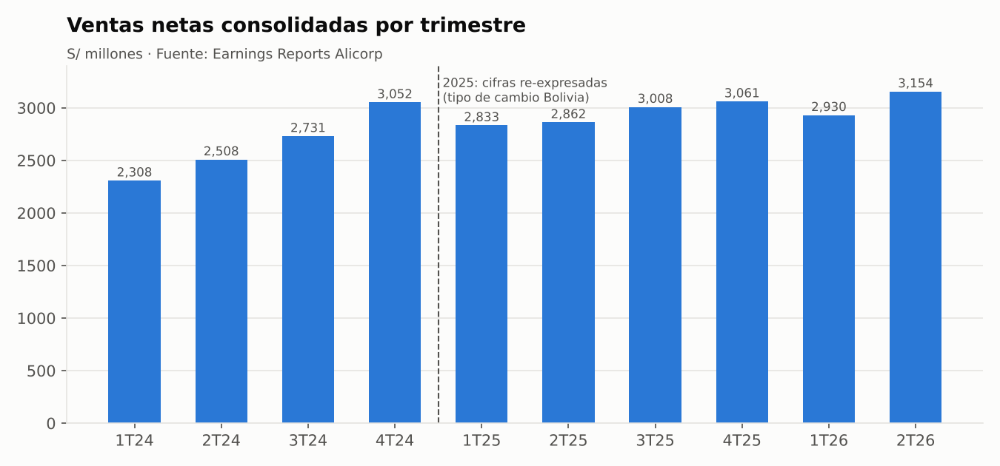

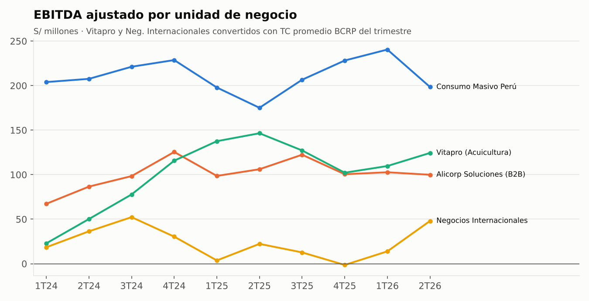

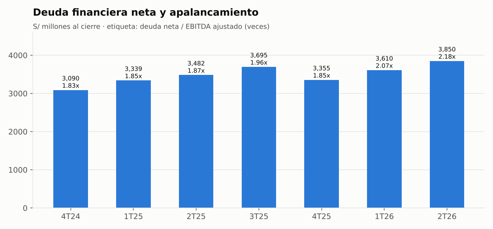

## Conclusiones y recomendaciones
**Conclusión:** Alicorp crece, pero crece vendiendo más volumen y no cobrando más; su ganancia operativa es estable y las caídas de utilidad neta vienen de ajustes contables de fin de año, no del negocio. El riesgo a vigilar es la combinación de un crecimiento dependiente del volumen con una deuda que sube por las adquisiciones.

Qué haría un analista con esto:
1. Seguir el **margen EBITDA de Vitapro** cada trimestre: es la unidad más volátil y la que más movió el resultado.
2. Medir el crecimiento de Consumo Masivo Perú **sin las adquisiciones** (orgánico) para saber si las marcas propias crecen solas.
3. No comparar Negocios Internacionales 2024 con 2025 sin advertir el cambio de tipo de cambio.
4. Vigilar que la **deuda neta / EBITDA no pase de ~2,5x** mientras se integran las adquisiciones.
5. Al proyectar un 4T, **presupuestar una partida no recurrente** (promedio histórico ≈ S/ 200 M) en vez de asumir que el EBITDA se traduce directo en utilidad neta.
6. Antes de celebrar un crecimiento de ventas, **separar precio y volumen**: el crecimiento por volumen es más frágil ante una baja de demanda.

**Límites:** los datos vienen de reportes públicos, no de la contabilidad interna; el 3T25 es derivado (total anual menos los otros trimestres); las cifras en dólares se convirtieron con el tipo de cambio del BCRP, que puede diferir ligeramente del que usa Alicorp. El detalle completo está en [docs/hallazgos.md](docs/hallazgos.md).

## El reto de los datos (y cómo lo resolví)
Los reportes no son una base de datos limpia:

| Problema | Solución |
|---|---|
| Alicorp **re-expresó 2025** al cambiar el tipo de cambio de Bolivia: el mismo trimestre tiene cifras distintas según el reporte | Usar siempre la versión más reciente, con una columna `fuente` en cada fila |
| No hay un 3T25 re-expresado publicado por separado | **Derivarlo**: total anual 2025 − 1T − 2T − 4T |
| Unas unidades reportan en soles y otras en dólares (y Negocios Internacionales cambió de moneda) | Convertir a soles con el tipo de cambio promedio trimestral del **BCRP** (API pública) |
| Negocios Internacionales 2024 no es comparable con 2025 | Marcarlo con la columna `comparable_con_2024` |
| ¿Están bien copiadas las cifras? | Script de validación: los trimestres de 2024 suman los totales anuales publicados (18 de 18 chequeos OK) |

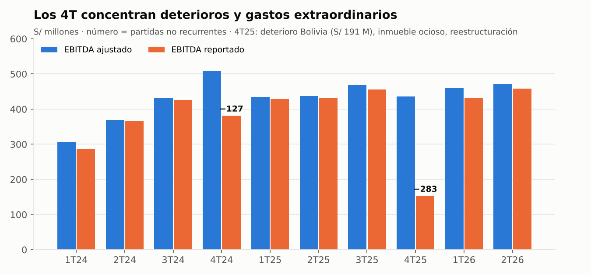

## Dashboard en Power BI
Modelo estrella con 3 tablas de hechos (unidades, consolidado, deuda) y 2 dimensiones (trimestre, unidad), más medidas DAX:
- margen EBITDA;
- variación frente al mismo trimestre del año anterior;
- precio por kg;
- participación por unidad;
- deuda como saldo de cierre.

Documentación técnica: [docs/documentacion_powerbi.md](docs/documentacion_powerbi.md) · Archivo: `powerbi/alicorp_dashboard.pbix`

El dashboard tiene 6 páginas:

**1. Resumen ejecutivo**: ventas, variación frente al mismo trimestre del año anterior, margen EBITDA y apalancamiento.

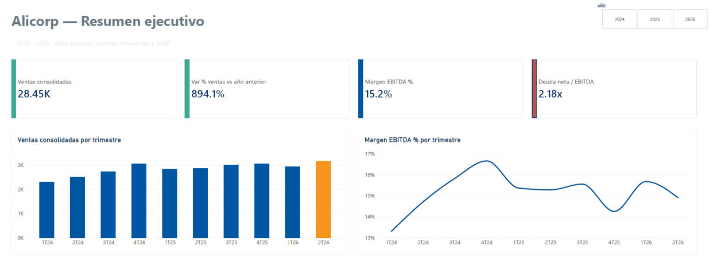

**2. Unidades de negocio**: EBITDA ajustado y participación de cada unidad en el EBITDA del grupo.

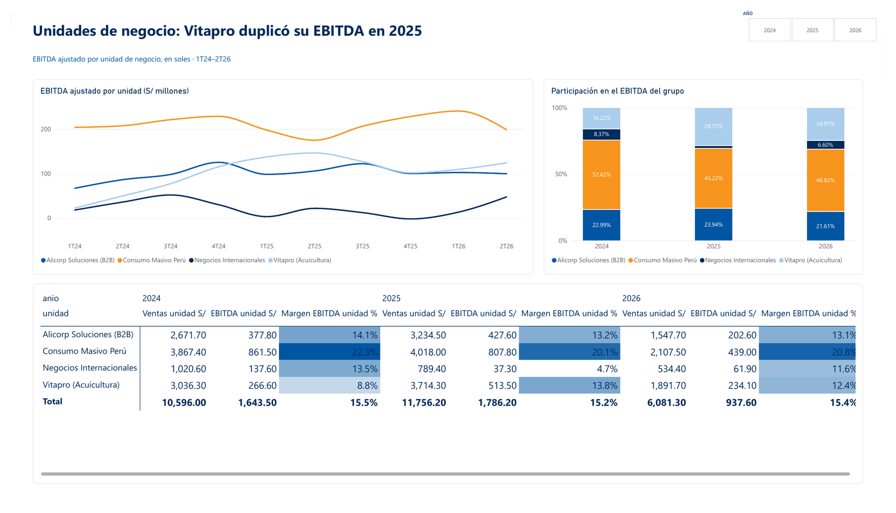

**3. Calidad de la utilidad**: EBITDA ajustado vs. reportado y utilidad neta por trimestre.

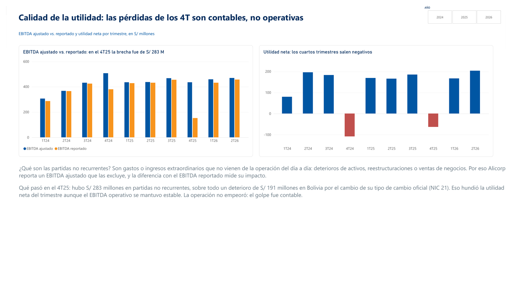

**4. Deuda y adquisiciones**: deuda financiera neta y deuda neta / EBITDA.

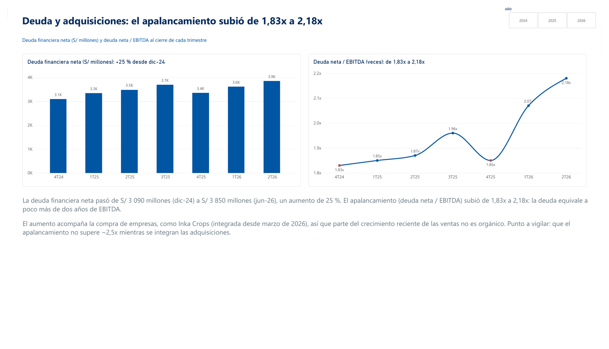

**5. Notas de datos**: fuente y moneda original de cada fila del dataset.

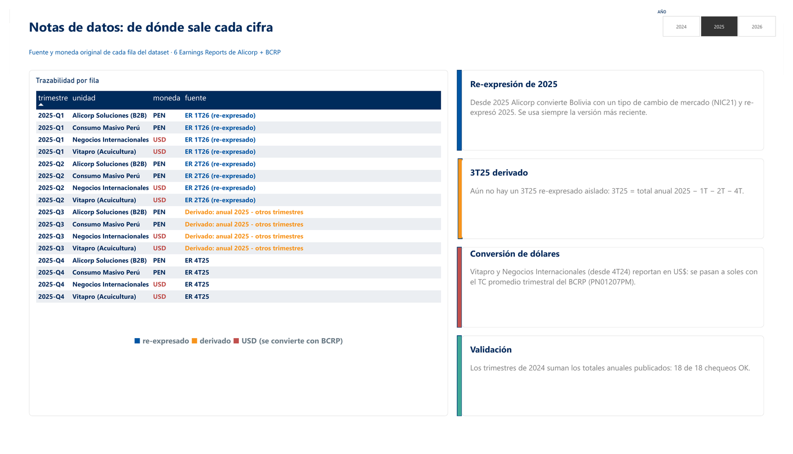

**6. Precio vs. volumen**: descomposición del crecimiento de ventas 2025 y márgenes promedio por trimestre.

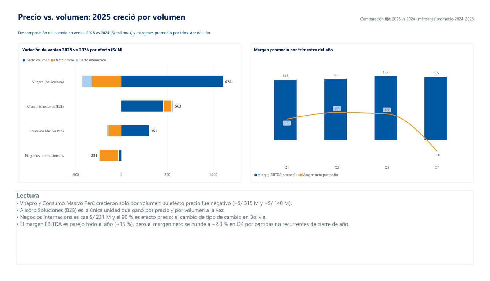

## Consultas SQL
Además de Python y Power BI, cargué el dataset en una base **SQLite** con el mismo modelo estrella (`sql/schema.sql`: llaves primarias y foráneas, restricciones `CHECK` y una tabla de control con los totales publicados) y respondí cada pregunta de negocio con una consulta:

| Consulta | Pregunta | Técnicas |
|---|---|---|
| [`01_variacion_interanual.sql`](sql/01_variacion_interanual.sql) | ¿Cómo cambian las ventas frente al mismo trimestre del año anterior? | `LAG()`, cláusula `WINDOW` |
| [`02_participacion_ebitda.sql`](sql/02_participacion_ebitda.sql) | ¿Qué unidad aporta más al EBITDA cada año? | `SUM() OVER (PARTITION BY)`, `RANK()` |
| [`03_ranking_crecimiento.sql`](sql/03_ranking_crecimiento.sql) | ¿Qué unidad creció más en 2025? | agregación condicional (`CASE`), `RANK()` |
| [`04_precio_volumen.sql`](sql/04_precio_volumen.sql) | ¿Se creció por precio o por volumen? | CTE encadenadas (`WITH`) |
| [`05_deuda_cierre.sql`](sql/05_deuda_cierre.sql) | ¿Cómo cambia la deuda con las adquisiciones? | subconsulta, saldo de cierre, `LAG()` |
| [`06_estacionalidad.sql`](sql/06_estacionalidad.sql) | ¿Los 4T son sistemáticamente peores? | `GROUP BY` + `AVG()` |
| [`07_control_calidad.sql`](sql/07_control_calidad.sql) | ¿Los datos cuadran con lo publicado? | `UNION ALL`, `JOIN` contra tabla de control |

Ejemplo: participación de cada unidad en el EBITDA del grupo, con una función de ventana por año.

```sql
WITH por_unidad AS (
    SELECT d.anio, u.unidad, SUM(u.ebitda_ajustado_pen) AS ebitda_pen
    FROM fact_unidades AS u
    JOIN dim_trimestre AS d USING (trimestre)
    GROUP BY d.anio, u.unidad
)
SELECT anio, unidad,
       ROUND(100.0 * ebitda_pen / SUM(ebitda_pen) OVER (PARTITION BY anio), 1) AS participacion_pct,
       RANK() OVER (PARTITION BY anio ORDER BY ebitda_pen DESC)               AS puesto
FROM por_unidad
ORDER BY anio, puesto;
```

| Año | 1.° | 2.° | 3.° | 4.° |
|---|---|---|---|---|
| 2024 | Consumo Masivo Perú 52,4 % | B2B 23,0 % | Vitapro 16,2 % | Neg. Internacionales 8,4 % |
| 2025 | Consumo Masivo Perú 45,2 % | **Vitapro 28,7 %** | B2B 23,9 % | Neg. Internacionales 2,1 % |

**Validación cruzada:** `src/05_consultas_sql.py` crea la base, corre las 7 consultas y compara sus resultados con los calculados en Python. La descomposición precio-volumen y la estacionalidad coinciden al decimal, y el control de calidad en SQL da 18 de 18 chequeos OK.

## Análisis avanzado: ¿por qué crecieron las ventas, y por qué son tan malos los 4T?
Dos preguntas que el análisis inicial dejaba solo cualitativas, ahora cuantificadas:

**¿El crecimiento de 2025 vino de vender más caro o de vender más?** Descomposición precio-volumen por unidad de negocio (ver [docs/hallazgos.md](docs/hallazgos.md#7-el-crecimiento-de-2025-fue-casi-todo-volumen-no-precio)): en Vitapro y Consumo Masivo Perú, el efecto precio fue **negativo** — todo el crecimiento fue volumen.

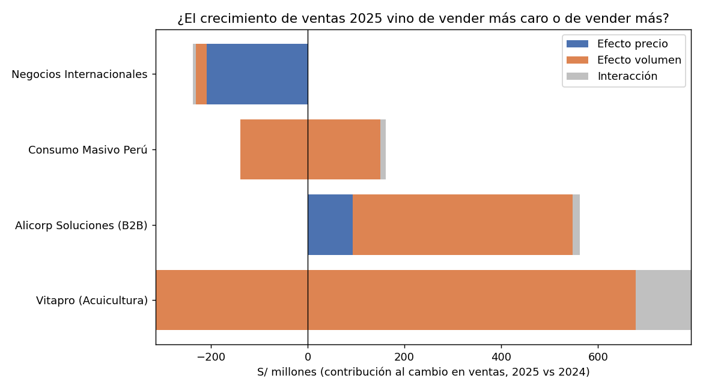

**¿Los 4T son realmente peores, o fue casualidad de 2 años?** Promediando cada trimestre (Q1-Q4) con los años disponibles: el margen EBITDA es parejo todo el año (~15 %), pero el margen de utilidad neta se desploma a **−2.8 % en Q4**, por partidas no recurrentes de cierre de año (ver [docs/hallazgos.md](docs/hallazgos.md#8-los-cuartos-trimestres-son-sistemáticamente-peores-en-utilidad-neta-no-en-ebitda)).

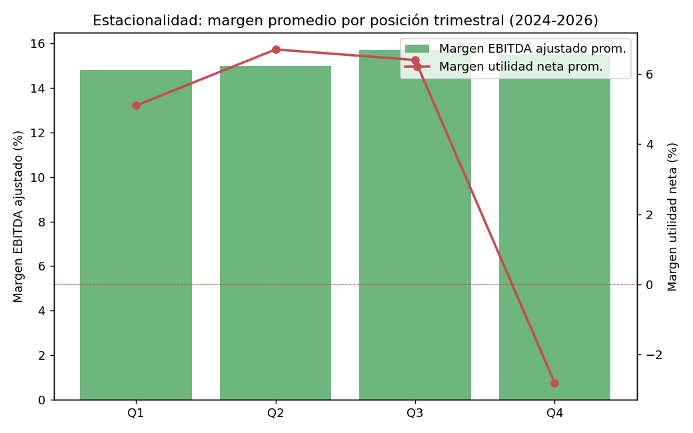

## Cómo reproducirlo
```bash
pip install -r requirements.txt
python src/01_construir_dataset.py   # genera data/processed/*.csv y alicorp_powerbi.xlsx
python src/02_validar.py             # chequea sumas contra los totales publicados
python src/03_graficos.py            # genera los gráficos de img/
python src/04_analisis_avanzado.py   # descomposición precio-volumen + estacionalidad
python src/05_consultas_sql.py       # crea data/alicorp.db, corre las consultas de sql/ y valida contra Python
```

## Estructura
```
data/raw/fuentes.md        enlaces a cada reporte y a la API del BCRP
data/processed/            CSV limpios + Excel para Power BI (y resultados de las consultas en sql/)
data/alicorp.db            base SQLite con el modelo estrella
sql/                       esquema y consultas SQL
src/                       construcción, validación, gráficos y análisis avanzado
docs/                      hallazgos y documentación técnica del dashboard
img/                       gráficos y capturas del dashboard
powerbi/                   dashboard de Power BI (.pbix)
```

## Fuentes
- Alicorp, Earnings Reports 1T25, 2T25, 3T25, 4T25, 1T26 y 2T26 (sección Inversionistas de alicorp.com.pe). Enlaces en [data/raw/fuentes.md](data/raw/fuentes.md).
- BCRP, serie PN01207PM (tipo de cambio interbancario promedio).

*Proyecto personal con información pública. No está afiliado a Alicorp y no es una recomendación de inversión.*

## Otros proyectos
Parte de mi portafolio de análisis de datos: [github.com/asramirez-svg](https://github.com/asramirez-svg)

**Autor:** Augusto Set Ramírez Ames: analista de datos, IBM Data Analyst Professional Certificate. [LinkedIn](https://linkedin.com/in/AugustoRamirezA)
